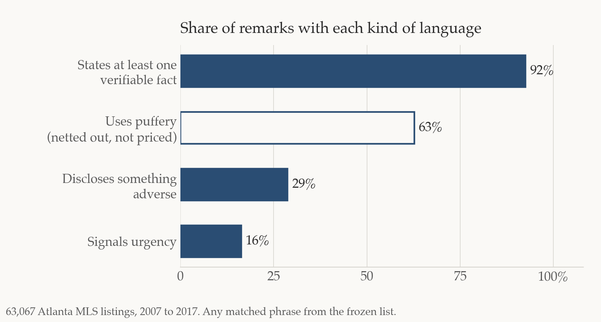

This is a post about putting an AI agent to work on a real estate valuation problem, with a real example. The agent is the same kind of tool I covered in [my workshop notes](/blog/notes-from-my-workshop-on-ai-agents/): it sits in a folder on your computer, reads the files there, and writes new ones. In this case the folder held the MLS listings for 63,067 houses sold in Atlanta over a decade, and the job was to turn the public remarks into numbers a house price model can use.

The example comes from a paper I presented on October 29, 2026, at the 4th ODU Real Estate Research Symposium in Norfolk, Virginia. The question in the paper is simple: when a listing agent writes the public remarks for a house, does the market price what the remarks say? To answer it I needed a measure of what the remarks say, and that is where the agent did its work. I want to write up how that works here, in plain terms, and how it compares with the ways researchers have measured listing text before. What the remarks turn out to be worth is in a second brief.

## The problem

All the house price models we use run on the structured fields. A hedonic regression, an AVM, a price index, the adjustment grid in an appraisal, they all start from square feet, bedrooms, bathrooms, age, lot, and a few flags. The remark gets dropped because it's text and the model needs numbers.

But anyone who has pulled comps knows the remark matters. "New roof, new HVAC, new water heater" and "charming, must see" are not the same house. The question is how to get that difference into the model in a way that is the same for every listing, that someone else can check, and that still carries the information.

Researchers have done this four ways. All four are good methods and I have no complaint about any of them. They differ in what they ask of the person who has to build the measure and keep it running, and that's what I want to talk about.

## Four ways

**1. Write the word list yourself.** Levitt and Syverson (2008) did this in the *Review of Economics and Statistics*. You pick a set of keywords and phrases, flag each listing for whether its description uses them, and put the flags in the price regression. In their Chicago data, "granite," "maple," and "gourmet" went with higher prices, "foreclosure," "as-is," and "handyman special" with lower ones, and "fantastic" and "charming" with nothing. It's transparent: the list is short enough to read in full, so you can see exactly what is being counted. The weakness is you only find what you thought to look for. Agents write in their own dialect, "proof of funds," "no blind offers," "seller never occupied," and a list written at a desk misses most of it.

**2. Put the frequent words in and let the statistics pick.** Nowak and Smith (2017) did this in the *Journal of Applied Econometrics*. You take the most frequent words and two-word phrases in the remarks, two thousand of them in their Atlanta data, make a yes/no flag for each, and run a method called LASSO that keeps only the flags that help predict price and drops the rest. Rare expressions never enter. But LASSO is built for prediction: it keeps a word only if the word improves the fit for the one outcome you gave it, and it drops everything else, including features of the house that matter but are already picked up by another word or by the structured fields. So the list it returns is not a list of what the remark says. It is the subset that helps predict sale price in that sample. Change the outcome to days on market and you get a different list; change the market and you get another. And what comes out is hundreds of words, each with a weight. You can predict price with it, but you can't say "bad news in the remark lowers price by this much," because there is no variable called bad news.

**3. Turn each remark into a vector.** This is what Steve Ross and I did in Shen and Ross (2021) in the *Journal of Urban Economics*. We used the paragraph vector method from Le and Mikolov (2014), a small neural network that learns to predict which words appear near which other words, and in doing so assigns every word and every description a position in a shared high-dimensional space. Descriptions that use similar language in similar ways end up close together, even when the words differ: "granit," "granite," and "hrwds" next to "hardwood floors" land in the same place, which no keyword list handles. We trained it on our own Atlanta corpus, measured how far each description sat from the other descriptions in the same area and year, and called that distance uniqueness. A one standard deviation increase in uniqueness went with a 15 percent higher sale price.

That model is a direct ancestor of today's large language models. The idea that a word's meaning is its position in a learned space, set by the company it keeps, is the same idea; the embedding layer of a modern model does the same job as our 2018 network, just with billions of parameters, attention on top, and training on most of the internet instead of about 41,000 remarks. So the breadth of method 3 is now free: you no longer train anything, you call a model. What has not changed is the cost. The vector still has no named dimensions. You can show that unusual descriptions are priced, but you can't say which feature is doing it, and you can't show a reviewer the phrase behind a number. That is the same limitation method 4 has, for the same reason. And in 2018 the pipeline had to be rebuilt for every new dataset. Ours took months.

**4. Ask an AI to rate each listing.** This is what most people try first now. You paste the remark into ChatGPT or Claude and ask for a score. The answers are usually sensible. But the model you used won't exist in two years, the score changes with how you word the question, rating a million records costs real money, and for any given score there is no phrase you can point to. A journal reviewer can't reproduce it, and a reviewer at a lender or an AMC can't audit it.

Here is what each method does best, and what it asks of you. The last row is my method, which the next section explains.

| Method | Strength | Limitation |
|---|---|---|
| 1. Word list you write | No technical or programming requirement. Someone who knows the market writes the list, and the list is short enough to read in full, so you can see exactly what is being counted. | Somewhat labor intensive, and it covers only the words you thought to include. |
| 2. LASSO on frequent words | Lets the data choose. Starts from the most frequent words in the remarks and keeps the ones that improve the fit. | Returns words with weights, not named categories. |
| 3. Text vectors | Keeps context. The whole remark, hundreds of words long, becomes one measure, so meaning that depends on the surrounding words is not lost the way it is in a word count. | High technical barrier. Building and training the model takes real skill in AI and machine learning, and the score reflects the entire passage, so you can't tell which part of the remark is driving it. |
| 4. Ask an AI to rate each listing | Quick to try. No list to build, and the model picks up anything a reader would. | Ratings change with the model version and the wording of the question. |
| 5. My method: an AI agent builds the phrase list, then a frozen list scores every listing | The agent reads every remark and finds how agents actually write, so the list is not limited to what you thought of. The list is then frozen, so every number is traceable to its phrases and anyone with the list and a script gets the same result. | Someone who knows the market still has to review the list before it is frozen. |

*All five work, and each has its own strengths and the settings it fits best. Mine is the one that is easiest to standardize and hand to someone else.*

*Walking through the strengths and limitations of each method at ODU, October 29, 2026.*

## What I do

I split the job in two and give the agent the first half.

**Stage one: the agent builds the phrase list.** I pointed a coding agent at the data file, told it what kinds of information to look for, and asked it to go through every remark and propose how to organize what it found. It came back the same morning with a set of categories and the expressions under each. I pushed back where it was too complicated for a finance paper, and when I saw that several of its categories were measuring the same thing, we cut them down to three: checkable facts about the house, bad news about the house or the deal, and signs the seller is in a hurry. A few others, like market-stress language and sales puffery, stayed in for checking. Its job is to find how agents actually say these things. In Atlanta that came to about 150 patterns in 16 groups, covering roughly 500 spellings, from "new roof" and "MARTA" to "proof of funds" and "seller never occupied." A second pass picked up phrases the first one missed. Then the list is frozen. That frozen list is the codebook.

**Stage two: the frozen list scores every listing.** For each remark, find the phrases from the list, keep a record of which ones matched, and turn the matches into three measures: facts about the house, bad news about the house or the deal, and signs the seller is in a hurry. In the paper the three are called residual information, adverse disclosure, and urgency pressure.

The agent isn't involved in stage two. Scoring is a phrase list and a matching script.

Here is how common each kind of language is. Nine in ten remarks state at least one checkable fact. Bad news and urgency are minorities but not rare.

*Share of the 63,067 remarks with at least one matched phrase of each kind. Puffery is measured but netted out, not priced.*

*The two stages. The agent is only in the top row.*

I did a smaller version of this once before, without an agent. In Shen and Wilkoff (2022), in the *Journal of Regional Science*, Sean Wilkoff and I needed to know whether Airbnb guests thought a unit was clean. We gave a word-association model (Mikolov et al., 2013) two seed words, clean and dirty, let it read all 140,601 guest reviews in our Austin data and return the words that travel with each, kept the ones that fit, and scored every review against the two fixed lists. Units guests perceived as clean increased their income by 17.5 percent and their occupancy by 16.5 percent after the pandemic began. The machine found the vocabulary, a person screened it, and a fixed list did the scoring. That is the same division of labor. What the agent changes is that it needs no seed words and reads for categories of information rather than for the neighbors of one word.

## Why this one, now

What changed is the cost of building the list. In 2018 the hard part was writing the text-processing code, and that limited who could do it. Now an agent builds the list in a morning from a plain-English instruction, and the hard part is making the result something another person can run and check. The two-stage method is built around that. It keeps the transparency of method 1 without the blind spot of a list written at a desk, and in practice a few things follow.

**It standardizes.** What stays fixed from market to market is the procedure: the categories, the instructions to the model, the review rules, the scoring, the checks. The words can be rediscovered for Phoenix or for 2026, because "virtual tour" doesn't mean what it meant in 2010. What's comparable across markets is the category, and that's the level a price index or a multi-market AVM needs anyway.

**It's the easiest to implement.** Once the list is frozen, applying it is something any analyst with Excel, Stata, or Python can do in an afternoon. An AVM team can run it in production as a lookup, and a review appraiser can see the phrases behind every score. You need the list and the script, and the three scores go into the model like any other field.

**You can explain every number.** If a score looks wrong, you open the remark and look at the matched phrases. In the talk I showed three real remarks. One was long and full of adjectives and scored well below average on information, because long isn't the same as informative. Another listed HVAC, plumbing, electrical, and "vandalized" and scored well above average on information and high on bad news at the same time. That one is informative, it's just not good news. You can't do that with a vector or an AI rating.

The paper is on SSRN: ["Cheap Talk or Priced Information? Listing Language and Housing Transaction Outcomes"](https://ssrn.com/abstract=7097938). What the three measures turn out to be worth, in prices, days on market, and model fit, is the subject of the next brief.
